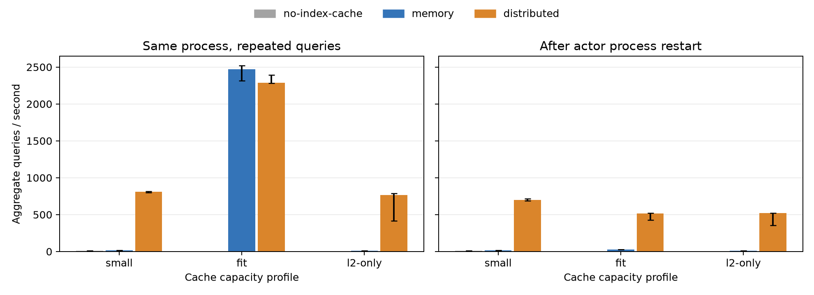

# Lance 12 two level cache performance

Measured on October 14, 2026, using Lance commit `ee7c7c6c2` and an optimized
`release-with-debug` wheel. With a small index-cache quota, two-level caching
delivered **55.6× the throughput of memory-only caching on repeated queries**
and **48.8× after actor restart**. With explicit eviction of local file pages
before restart, the gain was **28.9×**. When the full index fit in memory,
repeated-query throughput was 7.4% lower with two-level caching, while restart
throughput was 18.1× higher.

These results compare Lance's public session configurations on a synthetic
dataset served by MinIO on `blue-vova` over a 1 Gbit/s LAN. Configured index
cache quotas are equal between each pair; they are eviction budgets, not equal
physical RAM limits. All Ray query actors run on the primary machine.

## Throughput and latency

Each configuration has three trials with scenario order varied between trials.
Throughput is the median aggregate queries per second across four actors;
brackets show the observed minimum and maximum across trials. They are not
confidence intervals. Latency percentiles pool 768 query executions per row.

| Index-cache profile per actor | Phase | Memory only QPS [range] | Two level QPS [range] | Throughput ratio |
|---|---|---:|---:|---:|
| Small, 48 MiB total | Repeated queries | 14.58 [14.55–14.61] | 810.69 [799.09–817.74] | 55.6× |
| Small, 48 MiB total | After restart | 14.31 [14.30–14.33] | 698.25 [687.59–716.98] | 48.8× |
| Full index fits, 1,040 MiB total | Repeated queries | 2,468.82 [2,313.38–2,519.97] | 2,286.23 [2,281.51–2,391.44] | 0.93× |
| Full index fits, 1,040 MiB total | After restart | 28.62 [28.53–28.63] | 516.85 [429.37–519.58] | 18.1× |
| Partition L1 disabled, 16 MiB total | Repeated queries | 12.62 [12.59–12.63] | 763.33 [415.15–785.69] | 60.5× |
| Partition L1 disabled, 16 MiB total | After restart | 12.56 [12.55–12.56] | 522.94 [353.92–523.36] | 41.6× |

The full-index repeated passes took only about 0.10–0.11 seconds. Their
throughput ranges overlap, so the 7.4% median difference has limited precision.

| Profile | Phase | Memory only p50 / p95 / p99, ms | Two level p50 / p95 / p99, ms |
|---|---|---:|---:|
| Small | Repeated queries | 272.96 / 328.46 / 347.73 | 4.75 / 5.73 / 6.28 |
| Small | After restart | 279.08 / 329.20 / 360.66 | 4.78 / 6.78 / 39.32 |
| Full index fits | Repeated queries | 1.54 / 1.76 / 1.96 | 1.58 / 1.99 / 2.38 |
| Full index fits | After restart | 113.85 / 319.24 / 361.12 | 6.66 / 15.31 / 49.93 |
| Partition L1 disabled | Repeated queries | 318.23 / 349.09 / 358.01 | 5.15 / 10.59 / 11.94 |
| Partition L1 disabled | After restart | 319.83 / 351.32 / 373.59 | 7.13 / 12.38 / 40.02 |

The first measured pass after strict prewarm reached 521 QPS with the small
two-level cache versus 14.4 QPS with memory-only caching. Disabling the index
cache entirely produced about 10.2 QPS and 392 ms median latency; the small
two-level configuration was about 79× faster on repeated queries than this
additional control.

Restart phases cover the first 256 queries after creating new actors, so they
include gradual cache population. Actor creation and dataset opening precede
the query timers. The median first query after restart was 40 ms with the
small two-level cache versus 389 ms with memory-only caching, based on 12
first-query samples per configuration.

All phases, individual trials, source-read counts, and cache measurements are
available in [comparison.csv](comparison.csv) and
[trial_summary.csv](trial_summary.csv).

## Source reads and local storage

The small memory-only cache read 1.88 GiB from MinIO during each repeated
256-query pass. Two-level caching read zero source bytes in that phase. After
restart, the corresponding totals were 1.91 GiB versus 3.014 MiB, a **99.85%
reduction**. The remaining two-level source reads were index metadata: 24
read operations across four actors. The full-index configuration reduced
restart source reads from 975.90 MiB to the same 3.014 MiB.

Source counters are Lance's logical read-byte and read-operation deltas,
excluding transport overhead. They are separate from the actors' Linux
physical disk-read counters.

Strict prewarm populated 512 L2 entries per actor. Each replica occupied
303.80 MiB in file contents and 304.83 MiB in allocated filesystem blocks:
2,048 entries and approximately **1.19 GiB total file contents** across four
actors. The source index occupied 266.30 MiB. These are four complete index
replicas, each in its own directory. Lance's L2 has no automatic capacity
manager.

Populating all four two-level caches concurrently took a median 10.43 seconds
for the small profile, 10.54 seconds for the full-index profile, and 10.43
seconds with partition L1 disabled. Each population read about 1.11 GiB from
MinIO in aggregate. Prewarm time is excluded from the query tables; the
memory-only prewarm also took about 10.36 seconds. Cache persistence therefore
has an initial cost even though it eliminates most subsequent source reads.

## Restart with local file pages evicted

Three additional small-cache trials closed their sessions and called
`POSIX_FADV_DONTNEED` on all 2,048 persisted entry files before actor restart.
This operation is advisory. In every trial the restarted actors subsequently
recorded **1,104,162,816 bytes, or 1.03 GiB, of physical disk reads** in
aggregate, confirming that this workload reached local storage.

| After restart | Memory only | Two level |
|---|---:|---:|
| Median QPS [trial range] | 14.31 [14.31–14.34] | 413.14 [361.83–414.16] |
| p50 / p95 / p99, ms | 278.50 / 330.55 / 364.96 | 8.66 / 16.12 / 50.42 |
| Source read bytes per pass | 1.91 GiB | 3.014 MiB |

Two-level throughput remained 28.9× higher than memory-only caching. It was
41% lower than the main small-cache restart result, demonstrating the benefit
of the operating system's file cache. The main trials do not explicitly evict
file pages; residency is not guaranteed, and their raw events also record
some physical reads. This experiment restarts processes, not machines.
Detailed results are in [cold-l2/comparison.csv](cold-l2/comparison.csv).

## Workload and environment

| Setting | Value |
|---|---|
| Dataset | 1,000,000 Gaussian float32 vectors, dimension 256; one fragment |
| Index | IVF_RQ, L2 distance, 512 partitions, 8-bit codes, all rows indexed |
| Queries | 256 deterministic vectors, seed 44; `k=10`, `nprobes=16` |
| Projection | `_distance` and `_rowid`; no payload columns or exact reranking |
| Concurrency | Four actors, one synchronous query at a time per actor, 64 queries each |
| Prewarm | Strict, all partitions; new L2 directories for every trial |
| Memory-only backend | Default QuickCache index cache |
| Two-level backend | Moka metadata L1, optional Moka decoded-partition L1, local-file L2 |
| Two-level capacities | Metadata 16 MiB; partition L1 32 MiB, 1,024 MiB, or disabled |
| File metadata cache | Same default 16 MiB in every scenario |
| Thread limits per actor | Lance CPU 1, Lance IO 8; OpenBLAS, OMP, and MKL 1 |
| Primary host | Intel i7-9700K, 8 cores, 32 GiB RAM, Samsung 970 EVO Plus 1 TB, ext4 |
| Source host | `blue-vova`, matching CPU, RAM, and SSD; MinIO over 1 Gbit/s Ethernet |
| Software | Python 3.12.3, Ray 2.58.0, pylance 12.0.0, PyArrow 26.0.0, NumPy 2.5.4 |

The inherited generator uses successive batch seeds starting at 42. With
200,000 rows per batch, the measured seed-44 queries equal stored vectors at
row offsets 400,000–400,255, verified against the dataset. These are synthetic
queries for vectors present in the dataset; they are not an ANN recall
evaluation on held-out queries. See [query_workload.json](query_workload.json).

The primary machine retained its `powersave` CPU governor and normal desktop
workload; the source machine used `performance`. Ray CPU reservations are not
OS CPU affinity. Three trials expose observed variation, particularly when
partition L1 is disabled. The topology measures replicated query actors with
a remote S3 source. It does not measure partition-sharded routing or cloud S3
latency.

The wheel was built from the clean Lance feature range
`78b0e594a..ee7c7c6c2`, including implementation commit `bf6fa8d75` and its
usage and design documentation. Native extension and wheel SHA256 values,
hardware information, and MinIO's pinned source version are retained in
[environment.json](environment.json). Dataset creation used a release build
before the final wheel was ready; every reported query run used the final
`release-with-debug` wheel. Dataset identity and source object sizes are in
[dataset.json](dataset.json) and [source_objects.json](source_objects.json).

## Cache memory accounting

All recorded index eviction weights were within their configured quotas. In
the small profile, repeated-query weights summed to 191.09 MiB across the four
memory-only actors and 131.37 MiB across the two-level actors. Full-index
weights were about 1,092 MiB aggregate for both configurations.

`Session.size_bytes()` is a deep allocation estimate, not RSS or a quota
counter. With the small two-level cache it reported about 1,020 MiB aggregate
after repeated queries despite the 131 MiB eviction weight. The deep estimator
can overcount shared Arrow IPC backing buffers, and pending Moka maintenance
also affects its traversal. The L2 read path weights entries by serialized
length, which differs from decoded allocation accounting.

A separate single-actor [memory probe](memory_probe.json) recorded a 32.81 MiB
cache weight, a 254.83 MiB session estimate, and approximately 400 MiB process
RSS after draining maintenance. Process RSS includes Python, native libraries,
and allocator-retained memory. Equal configured capacities therefore compare
public cache policies without establishing equal physical RAM use. Statistics
collection and pending maintenance run outside the throughput timers.

## Benchmark fixes and validation

The Ray benchmark now uses the current cache API and default QuickCache
baseline, times each `k` independently, records source IO and result digests,
and verifies process placement on restart. It also supports explicit local
file-page eviction and records physical IO. Cache statistics and directory
scans were moved outside the throughput timer so their cost cannot distort
the comparison. Native MinIO startup and bucket creation work without Docker
Compose or an accessible container image.

The completed comparison comprises nine main runs and three additional
page-eviction runs. All **20,992 query executions** returned matching ordered
row IDs across scenarios, phases, and runs, with exactly `k` rows and finite
distances. All **108 actor restarts** created new PIDs on their original Ray
nodes and retained 512 L2 entries per distributed actor. Exact invalidation
cleared all four actor namespaces, including live entries and tombstones,
in 64 ms aggregate wall time; strict rehydration restored the entries in
10.71 seconds and preserved query results. See [audit.json](audit.json).

All 34 benchmark tests passed on the final wheel, including an integration
test with two fragments, restart, invalidation, and recall assertions.
Ruff 0.8.4, Black 22.10.0, ShellCheck, and `git diff --check` passed. No Lance
source changes were needed. The benchmark changes are in the Ray working tree.

Raw configurations, actor events, summaries, and run logs are preserved under
[raw/main](raw/main/) and [raw/cold](raw/cold/). The exact command script is
[commands.sh](commands.sh); use new run IDs when repeating it so prewarm
starts with empty cache directories. The benchmark source snapshot,
requirements, build logs, test output, and checksums accompany this report.
For repository storage, the source patch is losslessly compressed as
[benchmark.patch.gz](benchmark.patch.gz). The dataset verification log is
gzip-compressed and split into three files below the repository's size limit;
restore it with `cat logs/dataset-verify.log.gz.part* | gzip -dc`.
CSV line endings and JSON/SVG whitespace are normalized, and `SHA256SUMS`
covers the stored files.
Earlier measurements with statistics inside the throughput timer remain in
`initial-instrumentation/` and are excluded from every result above. MinIO,
the source dataset, and the local L2 directories remain available for reuse.
