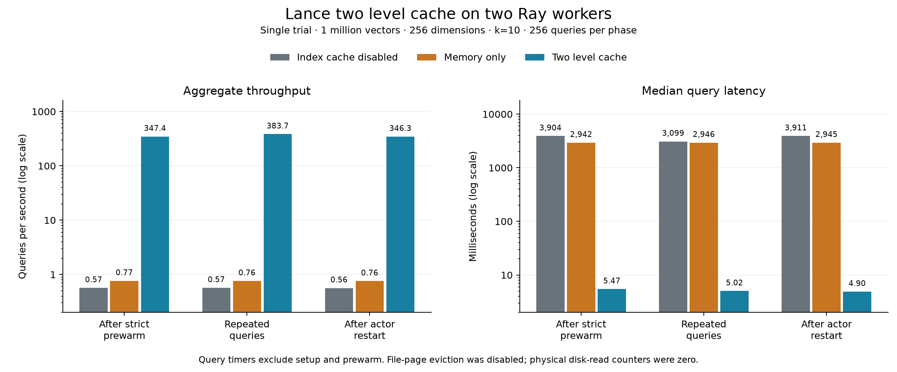

# Lance two level cache performance on two Ray workers

In a single real-cluster trial on October 15, 2026, the two-level cache reached
**383.74 queries per second on repeated queries**, versus **0.762 QPS with
memory-only caching**, a **503.6× throughput ratio**. In the reported actor
restart phase it reached **346.28 QPS**, a **456.8× ratio** over memory-only
caching. Median two-level query latency remained between 4.90 and 5.47 ms.

These are query-phase measurements after strict prewarm on a synthetic
one-million-vector IVF_RQ index. No file-page eviction was requested, and
physical disk-read counters were zero in every phase. The restart results are
consistent with reuse of persisted L2 files through the operating system's
file cache. Cold local-storage performance requires a separate measurement.

## Workload and placement

| Setting | Recorded value |
|---|---|
| Dataset | 1,000,000 float32 vectors, 256 dimensions, seed 42 |
| Index | IVF_RQ, 512 partitions, 8-bit codes; index name `vector_idx` |
| Queries | 256 per phase, split across two actors; `k=10`, `nprobes=16` |
| Concurrency | One synchronous query per actor; one Ray CPU reservation each |
| Worker hosts | `ns-bd-v100-05` and `ns-bd-v100-10`, with distinct Ray node IDs in the initial event excerpt |
| Source | MinIO endpoint `http://10.198.126.174:9000` |
| Dataset URI | `s3://lance-bench/ivf_rq_def2414a8c5d/` |
| Ray head | `10.198.127.149:6379` |
| L2 path | Separate actor directories under `/data/fast/lance-cache-bench/<run-id>/` |
| Index-cache budgets per actor | Memory only: 48 MiB; two-level: 16 MiB metadata L1 plus 32 MiB partition L1 |
| Prewarm | Strict, all partitions; prewarm and actor creation excluded from query timers |
| Threads per actor | Lance CPU 1, Lance IO 8; OpenBLAS, OMP, and MKL 1 |
| Software | Lance 12.0.0, Ray 2.58.0, Python 3.10.12, NumPy 2.2.6, PyArrow 25.0.1 |

`no-index-cache` disables the index cache while retaining metadata caching.
`memory` uses Lance's default in-memory index cache. `distributed` adds the
per-actor persistent L2 and separate metadata/partition L1 budgets. The
benchmark runs ordinary replicated queries and projects distances and row IDs.

The configured 256 warmup queries are used by natural prewarm; this run selected
strict whole-index prewarm instead. `initial` is the first measured pass after
that prewarm, `l1_warm` repeats the same queries in the same actors, and
`process_restart` measures queries after the configured actor recreation.

## Throughput and latency

Throughput is the aggregate query count divided by driver wall time for the
phase. Each row represents 256 queries, with 128 assigned to each actor.
Speedup ratios below divide two-level QPS by the corresponding baseline QPS.
Wall times include result validation and Ray call completion; cache statistics
collection runs after the throughput timer stops.

| Phase | Index disabled QPS | Memory only QPS | Two level QPS | Ratio vs memory | Ratio vs index disabled |
|---|---:|---:|---:|---:|---:|
| After strict prewarm | 0.568 | 0.766 | 347.38 | 453.2× | 612.0× |
| Repeated queries | 0.570 | 0.762 | 383.74 | 503.6× | 673.1× |
| After actor restart | 0.564 | 0.758 | 346.28 | 456.8× | 613.6× |

Two-level query passes took 0.667–0.739 seconds, compared with 334–338 seconds
for memory-only caching and 449–454 seconds with the index cache disabled.
These subsecond two-level passes are short; a single trial does not establish
the variability of the throughput ratios.

Latency percentiles pool the 256 per-query timings in each phase. They are
separate from aggregate throughput and exclude per-query result validation.

| Phase | Memory only p50 / p95 / p99, ms | Two level p50 / p95 / p99, ms |
|---|---:|---:|
| After strict prewarm | 2,941.82 / 3,028.57 / 3,927.03 | 5.47 / 7.08 / 9.10 |
| Repeated queries | 2,946.46 / 3,029.05 / 3,909.13 | 5.02 / 5.88 / 6.25 |
| After actor restart | 2,944.63 / 3,024.17 / 3,908.12 | 4.90 / 7.48 / 9.03 |

The memory-only median latency was **586.5× the two-level median** on repeated
queries. The corresponding p95 ratio was **515.3×**. The index-disabled
baseline's median latency ranged from 3,098.63 to 3,911.08 ms across phases.



The chart shows this single trial, without trial ranges. Full-resolution values
are retained in [summary.csv](summary.csv); [performance.svg](performance.svg)
is available for export.

## Source reads and persistent storage

The table reports aggregate logical source reads across both actors. GiB and
MiB use binary units; read operations are counts over the whole phase.

| Phase | Index disabled, GiB / operations | Memory only, GiB / operations | Two level, MiB / operations |
|---|---:|---:|---:|
| After strict prewarm | 2.665 / 38,144 | 1.876 / 26,984 | 0 / 0 |
| Repeated queries | 2.665 / 38,144 | 1.888 / 27,144 | 0 / 0 |
| After actor restart | 2.666 / 38,216 | 1.898 / 27,364 | 1.507 / 12 |

Two-level caching eliminated measured source reads in the initial and repeated
passes. After restart it read **1,580,080 bytes in 12 operations**, versus
**2,038,107,000 bytes** with memory-only caching: a **99.922% reduction**. These
counters establish source avoidance; they do not distinguish L1 hits from L2
hits or identify the objects behind the remaining reads.

The two-level summary retained **1,024 L2 entries and 637,112,832 bytes
(607.60 MiB)** across both actors in every phase. These are aggregate file
contents, with a mean of 303.80 MiB per actor; per-actor distributed-cache
snapshots were not included in the supplied excerpt. Physical disk-read
counters remained zero, so the recorded query times do not establish SSD/NVMe
read latency or throughput.

The supplied prewarm records cover only the index-disabled scenario: 63.42
seconds of wall time, 595,614,308 source bytes (568.02 MiB), and 8,792 source
operations across the two concurrent actors. Two-level prewarm timing is needed
to calculate its full startup cost or an amortization point.

## Cache memory accounting

All figures below sum both actors. The memory-only and two-level configurations
each had a 96 MiB aggregate index budget. The index-disabled scenario used zero
index-cache weight.

| Phase | Scenario | Index eviction weight, MiB | Session allocation estimate, MiB | L2 file contents, MiB |
|---|---|---:|---:|---:|
| Repeated queries | Memory only | 95.74 | 96.17 | 0 |
| Repeated queries | Two level | 65.71 | 510.33 | 607.60 |
| After actor restart | Memory only | 95.37 | 95.80 | 0 |
| After actor restart | Two level | 65.91 | 65.99 | 607.60 |

The memory-only cache operated near its eviction budget while continuing to
read about 1.9 GiB from the source per pass. This is consistent with recurring
partition misses under the small cache quota.

`Session.size_bytes()` is a deep allocation estimate that can count shared
Arrow backing buffers multiple times; it is not process RSS. Its change from
510.33 to 65.99 MiB across the two-level restart does not establish an equivalent
reduction in resident RAM. Equal configured budgets compare the public cache
configurations without establishing equal physical memory usage.

## Validation and interpretation

The summary contains all nine expected scenario/phase combinations and
**2,304 timed query executions**. Its QPS values agree with `n / wall_time_s`.
The supplied initial actor-0 measurement contains 128 latency samples and
1,280 returned rows at `k=10`, consistent with the configured split. Its single
row-ID digest does not establish result equality across scenarios. A complete
event stream is required to audit those digests and the restarted actors' PIDs
and node placement. Invalidation was disabled for this run.

This trial used a fixed scenario order: index disabled, memory only, then
two-level. The query vectors repeat between phases. Under the benchmark's
generator and configured batch size, query seed 44 also occurs in a generated
dataset batch; these synthetic queries do not establish held-out ANN recall.
The large source-read reduction supports the observed advantage for this
workload. Source-service and network timings were not recorded, so the
multi-second baseline latency cannot be attributed to a particular network,
MinIO, or retry mechanism.

The exact Lance build commit was not recorded: `lance_build_commit` is empty.
The target commit fields describe the benchmark's expected cache API and do not
identify the installed binary. Three or more repeated trials with scenario
order varied, plus a separate file-page eviction run, would establish observed
variation and the behavior when L2 reads reach local storage.

## Artifacts and reproduction

Run: `run-20261015T130627Z-2336852`, whose identifier records
October 15, 2026 at 13:06:27 UTC. The supplied configuration and summary are
preserved as [run.json](run.json) and [summary.csv](summary.csv). The six supplied
events are preserved as [events_excerpt.jsonl](events_excerpt.jsonl), explicitly
separate from a complete event log. Computed ratios and arithmetic checks are
in [derived_metrics.json](derived_metrics.json). [SHA256SUMS](SHA256SUMS) covers
the source artifacts, report, analysis script, and chart exports.

Recompute the comparisons and regenerate the PNG/SVG chart by running this
command from the Ray repository root using the benchmark environment:

```bash
benchmarks/lance_distributed_cache/.venv/bin/python \
  benchmarks/lance_distributed_cache/results/two-level-cache-real-cluster-20261015/analyze_artifacts.py
```

The script reads only the saved artifacts and does not connect to the cluster.
